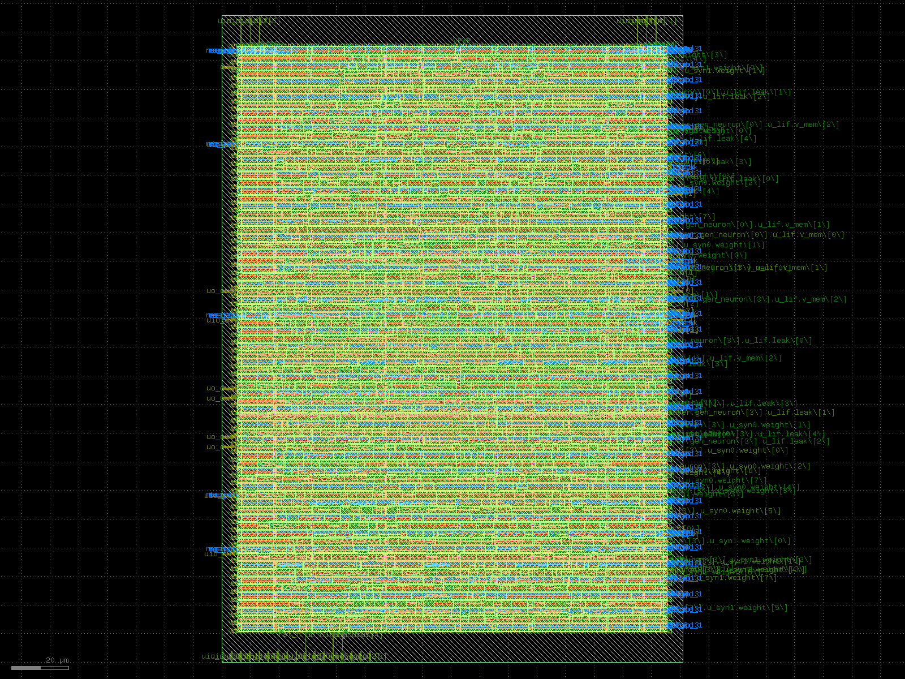
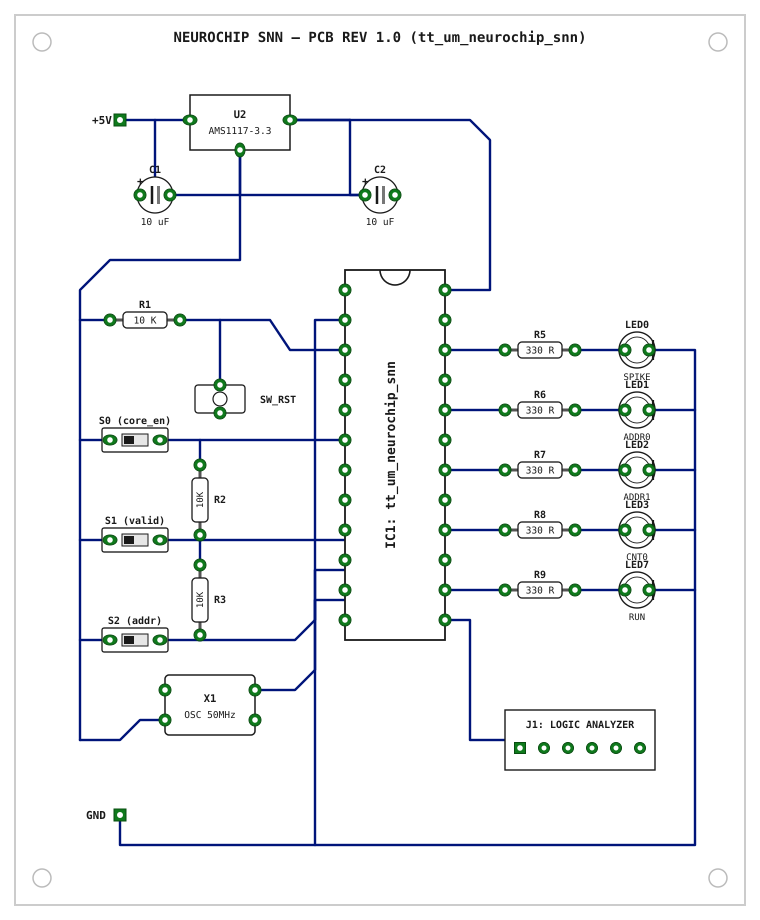

# NeuroChip SNN — Núcleo Neuromórfico (LIF + STDP + AER)

Implementação completa em Verilog RTL de um processador neuromórfico baseado em **Spiking Neural Network (SNN)** com neurônios **LIF (Leaky Integrate-and-Fire)**, plasticidade sináptica **STDP**, roteamento **AER (Address-Event Representation)**, fluxo completo de **ASIC Sky130 (Tiny Tapeout `1×2`)**, **FPGA PnR (`iCE40` e `ECP5`)**, **layout PCB de bancada** e **dashboard interativo em Streamlit**.

---

## 1. Resumo Técnico e Aprovação (Signoff)

| Frente | Alvo / Ferramenta | Resultado Consolidado |
| :--- | :--- | :--- |
| **ASIC (Sky130 / OpenLane)** | Tiny Tapeout `1×2` (`tt_um_neurochip_snn`) | Área `161.0 × 225.76 µm` (`0.03635 mm²`), `4.058` células, **0 violações Magic DRC**, `WNS = 0.0 ns`, `TNS = 0.0 ns` @ **50 MHz** (`tt_um_neurochip_snn.gds` — 3.9 MB) |
| **FPGA iCE40** | Yosys + nextpnr-ice40 (14 pinos fixos) | `572` LUT4, `172` FFs, `759/1280` LCs (`59%`), **`96.26 MHz`** (Aprovado a 12 MHz) → `build/neurochip_ice40.bin` |
| **FPGA ECP5** | Yosys + nextpnr-ecp5 (14 pinos fixos) | `408` LUT4, `164` CCU2C, `172` FFs (`3%`), **`103.42 MHz`** (Aprovado a 25 MHz) → `build/neurochip_ecp5.bit` |
| **Release & Submissão** | GitHub Release `v1.0.0` + `build/tt_submission/` | GDSII, bitstreams, métricas e pacote `build/tt_submission_1x2.tar.gz` prontos para o template oficial |

---

## 2. Leiaute Físico do Silício (GDSII — Sky130 `1×2`)



---

## 3. Esquema Eletrônico e Leiaute PCB de Bancada



### Pinagem Principal (`tt_um_neurochip_snn`)

| Sinal | Direção | Função no Hardware |
| :--- | :---: | :--- |
| `clk` | Entrada | Clock principal (`50 MHz` ASIC / `12–25 MHz` FPGA) |
| `rst_n` | Entrada | Reset assíncrono ativo em nível baixo (`SW_RST` + pull-up `R1 = 10 kΩ`) |
| `ena` | Entrada | Habilitação do tile Tiny Tapeout (ligado em `+3.3V`) |
| `ui_in[0]` | Entrada | `core_en` — habilita o núcleo SNN (`S0` + pull-down `R2 = 10 kΩ`) |
| `ui_in[1]` | Entrada | `aer_in_valid` — pulso de evento AER (`S1` + pull-down `R3 = 10 kΩ`) |
| `ui_in[2]` | Entrada | `aer_in_addr` — endereço do canal de entrada (`S2` + pull-down `R4 = 10 kΩ`) |
| `uo_out[0]` | Saída | `aer_out_valid` — detecção de disparo (`R5 = 330 Ω` → `LED0`) |
| `uo_out[2:1]` | Saída | `aer_out_addr[1:0]` — endereço do neurônio disparado (`R6..R7` → `LED1..LED2`) |
| `uo_out[6:3]` | Saída | `spike_cnt[3:0]` — contador de disparos de 4 bits (`R8` → `LED3..LED6`) |
| `uo_out[7]` | Saída | Situação `core_en` ativa (`R9 = 330 Ω` → `LED7`) |

### Lista de Materiais (BOM — Bancada / PCB)

| Bloco | Componentes | Função |
| :--- | :--- | :--- |
| **Alimentação** | `U2` AMS1117-3.3, `C1` 10 µF, `C2` 10 µF, `C3` 100 nF, `R0` 330 Ω, `LED_PWR` | Regulação `5V → 3.3V`, filtragem, desacoplamento do CI e indicação de energia |
| **Clock & Reset** | `X1` Oscilador 50 MHz CMOS 3.3V, `SW_RST`, `R1` 10 kΩ | Geração de clock e circuito de reset ativo-baixo |
| **Entradas AER** | `S0`, `S1`, `S2` (chaves/botões) + `R2`, `R3`, `R4` (10 kΩ) | Injeção manual de estímulos AER com pull-down |
| **Telemetria** | `LED0..LED7` + resistores limitadores `330 Ω` (`R5..R9`) | Visualização em tempo real de disparos, endereços e status |
| **Depuração** | `J1` Barra de pinos 2.54 mm (`CLK, RST, UI0, UO0, 3V3, GND`) | Conexão direta para analisador lógico (Saleae / PulseView) |

---

## 4. Dashboard Interativo (Streamlit — 6 Abas)

O painel `sim/dashboard_snn.py` integra simulação SNN, análise de disparos, signoff físico (`metrics.csv` + `docs/gds_die_layout.png`), esquema PCB (`docs/esquema_eletronico_snn.svg`) e exportação de relatório técnico (`.md`).

```bash
cd ~/neurochip_snn
source .venv/bin/activate
streamlit run sim/dashboard_snn.py
```

---

## 5. Compilação, Simulação e Gravação em FPGA

```bash
# Simulação RTL, síntese e PnR completos (iCE40 + ECP5)
./neurochip_snn.sh sim-all
./neurochip_snn.sh synth-all
./neurochip_snn.sh pnr-all

# Gravação em hardware (com a placa conectada na USB)
iceprog build/neurochip_ice40.bin
openFPGALoader -b <sua_placa_ecp5> build/neurochip_ecp5.bit
```

---

## 6. Submissão Tiny Tapeout (`1×2`)

O pacote `build/tt_submission_1x2.tar.gz` contém `info.yaml` (`tiles: "1x2"`, `top_module: "tt_um_neurochip_snn"`, `clock_hz: 50000000`), `src/` e `docs/info.md` prontos para extração na raiz do repositório criado a partir do template oficial (`TinyTapeout/ttsky-verilog-template`).
